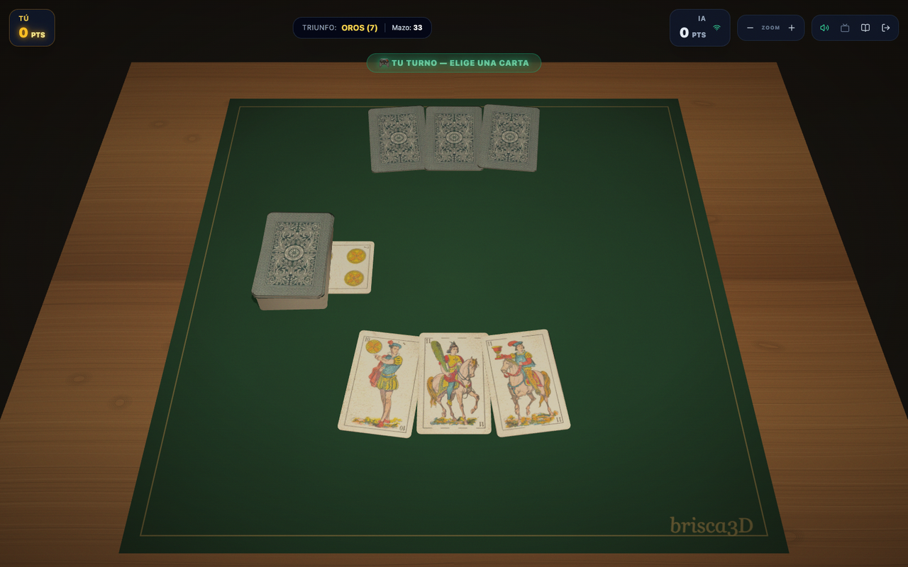

# Brisca 3D Royale 🎴✨

> **Juego de Brisca Española en 3D Online para 2 jugadores, instalable como PWA y con estética arcade inspirada en _Balatro_.**

**Online:** <https://brisca-3d.vercel.app> · **Práctica:** <https://brisca-3d.vercel.app/?solo=1>


[](LICENSE)
[](https://github.com/moisesvalero/brisca-3d)

---

## 🌟 Características

- **Responsive de verdad:** cámara con FOV/zoom adaptativo para vertical, horizontal y tablet; canvas redimensionable al girar y DPR máximo 2.
- **Manos apoyadas en la mesa:** tus cartas y las del rival quedan planas sobre el tapete, como al principio; la baza, el mazo y el triunfo también.
- **Baraja Española (40 cartas)** con el arte de la **baraja Fournier de 1878** (dominio público, Museo Fournier de Naipes), normalizada y restaurada a 512×810 WebP, con el reverso clásico de la imagen aportada por el usuario (azul pizarra y crema).
- **Mesa clásica**: base de madera de roble con relieve, tapete rectangular de fieltro verde cazador, línea dorada fina y sello «brisca3D».
- **Mazo 3D:** bloque con grosor dinámico según las cartas restantes, canto de hojas y cartas superiores desalineadas; el triunfo asoma plano por debajo.
- **Mano estable:** cartas planas, alineadas y apoyadas sobre el fieltro; el encuadre de cámara evita cortes en vertical y horizontal.
- **Animaciones y sombras:** vuelo parabólico al mover cartas, sombras suaves a 2048 y cartas que proyectan sombra sin recibirla.
- **Estética arcade Balatro**: cartas con esquinas redondeadas y volumen, partículas, _screen shake_ y filtro CRT.
- **Online en tiempo real**:
  - Salas privadas con código de 4 letras y enlace directo (`?room=ABCD`).
  - Servidor **autoritativo**: la mano rival nunca se envía al cliente.
  - **Reconexión automática** con token de sesión y 60 s de gracia.
  - Aviso de desconexión retrasado 2,5 s para que las reconexiones cortas sean invisibles.
  - **Revancha** cuando ambos jugadores la aceptan.
- **Modo Práctica (solo vs IA)** sin conexión.
- **Audio procedural**, vibración háptica y **PWA** instalable.
- **Accesibilidad**: mano jugable con teclado/lector de pantalla.
- **Reglas completas a mano:** botón en el lobby y en el HUD con un modal scrollable (puntos, bazas, triunfo y regla del 7 y 2).
- **Instalable en iOS y Android:** banner en móvil con guía para Safari y prompt nativo en Android/Chrome.



**Baraja:** [Fournier 1878, dominio público](CREDITS.md) · Museo Fournier de Naipes (Bibat).

---

## 📜 Reglas implementadas

- **40 cartas** (oros, copas, espadas, bastos).
- **Puntuación oficial (total 120):** As = 11 · Tres = 10 · Rey = 4 · Caballo = 3 · Sota = 2 · blancas = 0.
- Gana quien consiga **más de 60 puntos**; a 60 exactos, empate.
- Reparto de 3 cartas por jugador y triunfo descubierto bajo el mazo.
- No es obligatorio asistir ni superar palo.
- El ganador de la baza roba primero; al agotarse el mazo se recoge el triunfo.
- **Regla del 7 y 2** para cambiar el triunfo mientras quede mazo.

---

## 🏗️ Arquitectura

```text
Navegador  ──wss──▶  Vercel (PWA + /api/ws)  ──wss──▶  Cloudflare Worker
                                                         │
                                                         ▼
                                                Durable Object (BriscaRoom)
                                                         │
                                                         ▼
                                          @brisca/session (GameServer)
                                                         │
                                                         ▼
                                                    @brisca/core
```

- **Cliente + puente WebSocket:** Vercel (plan Hobby). El cliente está en `brisca-3d.vercel.app` y `/api/ws` reenvía el socket al servidor de juego.
- **Servidor de juego autoritativo:** Cloudflare Worker + Durable Object. Guarda las salas, los turnos y las manos; el cliente nunca ve la mano rival.
- **`@brisca/session`:** lógica compartida entre el servidor Node local y el Durable Object (sin duplicar reglas).
- **`@brisca/core`:** motor puro de reglas con tests.

El puente de Vercel existe porque algunos ISP bloquean el rango de IPs de `workers.dev`/`pages.dev`. Vercel sí es accesible y su red habla con Cloudflare; el Durable Object sigue siendo la única autoridad.

### Estructura

```text
brisca-3d/
├── api/ws.ts          # Puente WebSocket de Vercel
├── packages/
│   ├── core/          # Baraja, reglas, bazas, puntos (15 tests)
│   ├── session/       # Salas, turnos, reconexión, protocolo (11 tests)
│   ├── server/        # Servidor Node + ws para desarrollo local
│   ├── worker/        # Cloudflare Worker + Durable Object
│   └── client/        # React 19 + Three.js + Tailwind + PWA
├── pnpm-workspace.yaml
└── vercel.json
```

---

## 🚀 Desarrollo local

Requisitos: **Node 20+** y **pnpm 12+** (`corepack enable`).

```bash
pnpm install
pnpm dev
```

- Cliente: <http://localhost:3000>
- Servidor WebSocket: `ws://localhost:8080` · health: <http://localhost:8080/health>

Abre dos pestañas: una crea la sala y la otra se une con el código. Práctica: <http://localhost:3000/?solo=1>.

### Worker de producción en local

```bash
pnpm dev:worker   # wrangler dev en http://127.0.0.1:8787
```

Abre el cliente con `http://localhost:3000/?ws=ws://127.0.0.1:8787/ws`.

### Scripts

```bash
pnpm test         # core + session + servidor
pnpm check        # TypeScript en todos los paquetes
pnpm lint         # oxlint
pnpm format       # prettier
pnpm build        # cliente + servidor Node
pnpm deploy:worker # Cloudflare: worker + assets
pnpm deploy:web   # Vercel: cliente + /api/ws
pnpm release      # ambos
```

---

## 🌍 Despliegue (gratis)

| Componente                     | Plataforma              | Plan           |
| ------------------------------ | ----------------------- | -------------- |
| PWA + puente WebSocket         | Vercel                  | Hobby (gratis) |
| Salas + WebSocket autoritativo | Cloudflare Workers + DO | Free (gratis)  |

### Cloudflare

```bash
# Una vez: autoriza Wrangler (navegador) o exporta CLOUDFLARE_API_TOKEN
pnpm --filter @brisca/worker exec wrangler login
pnpm deploy:worker
```

El Worker queda en `https://brisca-3d-ws.<tu-subdominio>.workers.dev` (health: `/health`).

Si cambias el nombre o el subdominio, actualiza `WS_UPSTREAM`:

- En local: variable de entorno.
- En Vercel: _Project → Settings → Environment Variables_.
- O edita el valor por defecto en `api/ws.ts`.

### Vercel

```bash
pnpm dlx vercel@latest login   # si no tienes sesión
pnpm deploy:web
```

El cliente detecta automáticamente el puente:

- `*.vercel.app` → `wss://<host>/api/ws`
- `*.workers.dev` / `*.pages.dev` → `wss://<host>/ws`
- Local → `ws://<host>:8080`
- `config.json` o `VITE_WS_URL` mandan si están definidos.

### Límites del plan gratuito

- **Vercel Hobby:** cada conexión WebSocket dura como máximo **300 s**. El cliente reconecta solo y el Durable Object conserva la sala 60 s; el aviso al rival se retrasa 2,5 s, así que la partida continúa sin que se note.
- **Cloudflare Free:** 100.000 peticiones/día y 13.000 GB-s/día. Una partida completa usa ~100 mensajes; sobran partidas.
- El token de Cloudflare solo se usa para desplegar. Puedes revocarlo en <https://dash.cloudflare.com/profile/api-tokens>.

---

## 🔐 Configuración

| Variable      | Dónde                | Uso                                                    |
| ------------- | -------------------- | ------------------------------------------------------ |
| `WS_UPSTREAM` | Vercel               | URL `wss` del Worker (por defecto la de este proyecto) |
| `VITE_WS_URL` | Vercel / `.env`      | URL del WebSocket en build                             |
| `wsUrl`       | `public/config.json` | URL en runtime (prioridad)                             |
| `PORT`        | Servidor Node        | Puerto HTTP/WS (8080)                                  |
| `?ws=`        | URL del cliente      | Override puntual para pruebas                          |
| `?room=ABCD`  | URL del cliente      | Invitación directa a una sala                          |
| `?solo=1`     | URL del cliente      | Modo práctica                                          |

El token de reconexión se guarda en `sessionStorage` por sala; el apodo en `localStorage`. No hay cuentas ni datos personales en el servidor.

---

## 🧪 Calidad

- **31 tests**: motor, sesión y servidor (partida completa, revancha, reconexión, sala llena, rate limit, mensajes inválidos).
- TypeScript estricto, `oxlint` y `prettier` con Husky + lint-staged.
- CI en `.github/workflows/ci.yml`.
- E2E manual verificado en navegador real: crear/unirse, partida completa, revancha, enlace de invitación, modo IA y reconexión.

### Endurecimiento

- Salas de 4 caracteres sin ambigüedades y control de colisiones.
- Validación de turnos y cartas en el servidor (autoritativo).
- Límite de mensaje (8 KB), rate limit por conexión y validación de tipos.
- Token de sesión para reconectar; nadie puede ocupar una silla en gracia sin él.
- Cierre de sala al expirar la gracia de 60 s.
- Heartbeat ping/pong en Node; Cloudflare mantiene vivas las conexiones.

---

## 📄 Licencia

Código, escena 3D, texturas originales, efectos y audio: **[PolyForm Noncommercial 1.0.0](LICENSE)** © 2026 Moisés Valero Sánchez.

Puedes usar, estudiar, modificar y compartir el proyecto para fines **no comerciales**: uso personal, educativo, investigación, organizaciones sin ánimo de lucro u organismos públicos. **No se permite el uso comercial** sin autorización expresa.

- Las dependencias de terceros conservan sus licencias originales.
- Las caras de la baraja Fournier 1878 son de **dominio público**; consulta [CREDITS.md](CREDITS.md).
- Para un uso comercial, abre un issue en el [repositorio](https://github.com/moisesvalero/brisca-3d/issues).
